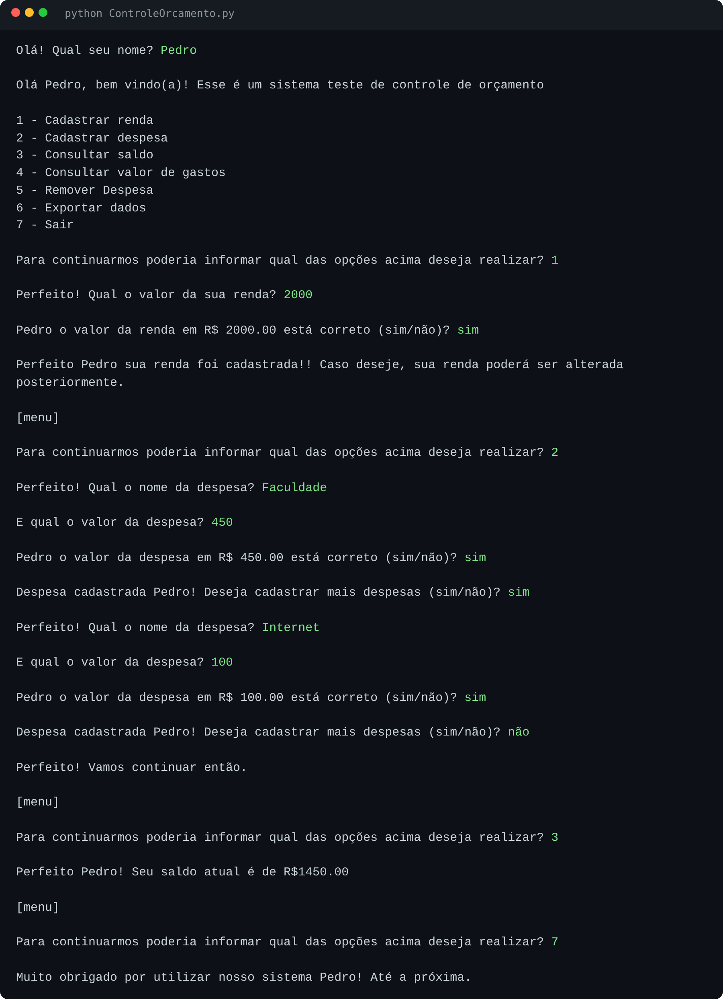

# Sistema de Controle de Orçamento

Programa de terminal feito em Python para controlar renda e despesas. Foi o meu primeiro projeto: nele treinei condições, laços, tratamento de erros, listas e exportação de dados para arquivo.



## O que ele faz

- **Cadastrar renda**: registra a renda e permite alterá-la depois.
- **Cadastrar despesas**: só aceita valores maiores que zero e que não ultrapassem o saldo disponível.
- **Consultar saldo**: mostra a renda menos as despesas cadastradas.
- **Consultar valor de gastos**: mostra o total gasto.
- **Remover despesa**: lista as despesas numeradas e remove a escolhida.
- **Exportar dados**: gera um arquivo CSV com o resumo e a lista de despesas.

O menu aceita o número da opção ou o nome dela (por exemplo, `1` ou `renda`). Se a pessoa digitar algo parecido, o programa sugere a opção certa ("Você quis dizer...?").

## Como rodar

Você só precisa do Python 3 instalado. Não é preciso instalar nenhuma biblioteca extra.

```
python ControleOrcamento.py
```

## Menu

```
1 - Cadastrar renda
2 - Cadastrar despesa
3 - Consultar saldo
4 - Consultar valor de gastos
5 - Remover Despesa
6 - Exportar dados
7 - Sair
```

## Arquivo exportado

O arquivo é salvo na mesma pasta do programa, com o nome `<seu nome>Despesas.csv`. Ele usa ponto e vírgula como separador, então abre direto no Excel. Exemplo:

```
Nome;Renda;Despesas Totais;Saldo Restante
Ana;1000,0;300,0;700,0

Despesas;Valor
faculdade;300,00
```

O CSV só é criado (ou atualizado) quando a opção 6 é escolhida. Se você cadastrar ou remover uma despesa depois, exporte de novo para atualizar o arquivo.

## Limitações

Os dados ficam apenas na memória enquanto o programa está aberto. Ao fechá-lo, o que não foi exportado para CSV é perdido.

## O que pratiquei neste projeto

- Laços `while` e `for`
- Condicionais (`if`, `elif`, `else`)
- Tratamento de erros com `try/except`
- Listas e remoção de itens com `.pop()`
- Escrita de arquivos com o módulo `csv`
- Sugestão de opção parecida com `difflib.get_close_matches`
